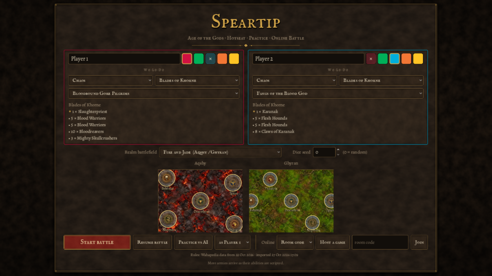

# Speartip downloads

Compiled apps for **Age of the Gods: Speartip**, a tabletop battle game with practice, hotseat and online play.

## Download version 0.1

Get the app for your computer from [release 0.1](https://github.com/HeyitsTayters/speartip-releases/releases/tag/0.1):

| Platform | Download |
| --- | --- |
| Windows (64-bit Intel/AMD) | Upload pending |
| Linux (64-bit Intel/AMD) | Upload pending |
| macOS (Apple Silicon and Intel) | [macOS ZIP](https://github.com/HeyitsTayters/speartip-releases/releases/download/0.1/Speartip-0.1-macos-universal.zip) |

Extract the ZIP before launching. On Windows, run `Speartip.exe`. On Linux, run `Speartip.x86_64` (if needed, enable executable permission with `chmod +x Speartip.x86_64`). On macOS, move `Speartip.app` to Applications and open it.

These builds are unsigned on Windows and ad-hoc signed, without notarization, on macOS. Your operating system may ask you to approve opening the downloaded app.

Online players should use the same release. Release **0.1** contains game build **0.3.29**; the download release number is separate from the game's compatibility version.

`SHA256SUMS.txt` accompanies the downloads for file verification. This repository distributes compiled apps and download instructions only. Game source is maintained separately.
